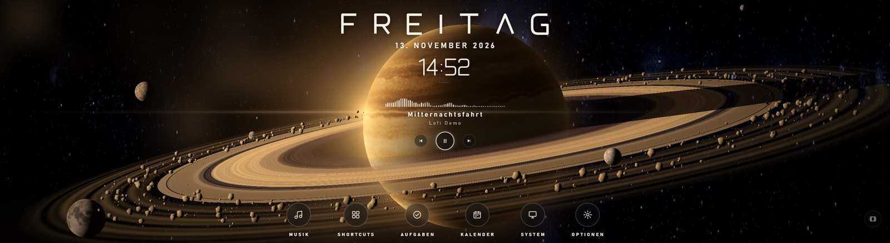
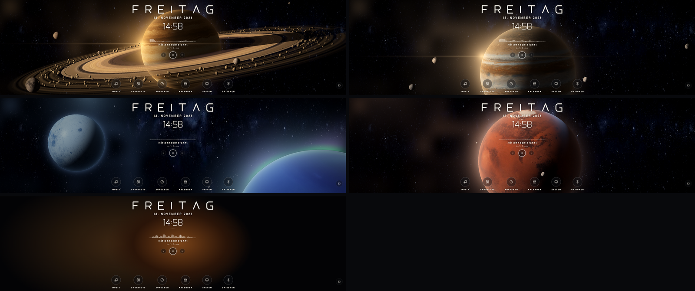
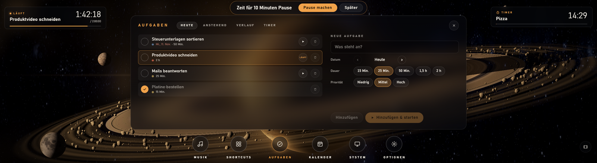
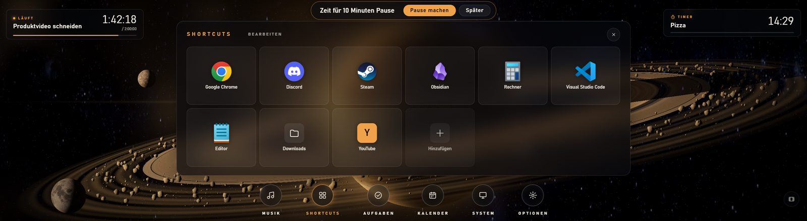
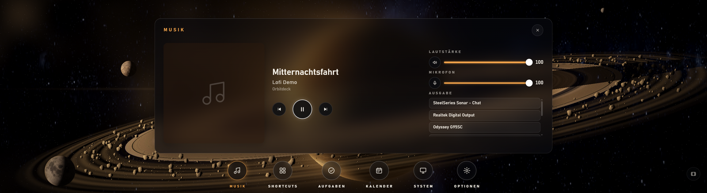
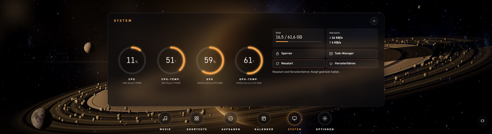
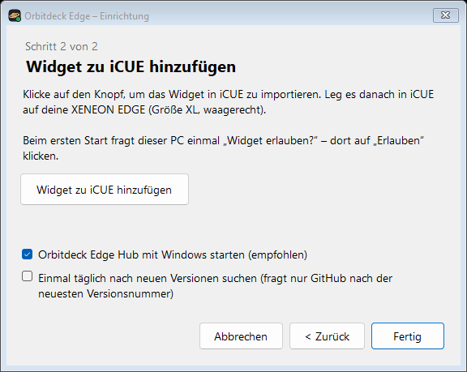
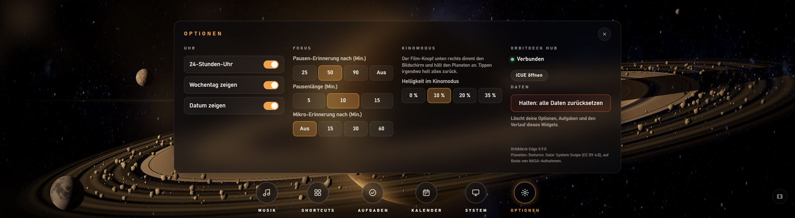

# Orbitdeck Edge

**Eine lebendige Weltraum-Szene mit Uhr, Aufgaben, Musik und Shortcuts – auf der CORSAIR XENEON EDGE.**

Hinter einer großen Uhr dreht sich langsam ein Ringplanet, Monde ziehen ihre Bahnen und Felsbrocken treiben durch die Ringe. Die Symbole darunter öffnen deine Aufgaben und Fokus-Sitzungen, einen Kalender, die Musiksteuerung mit Visualizer, deine Lieblingsprogramme und CPU/GPU/RAM auf einen Blick.

Kostenlos und Open Source. Kein Konto, keine Server, kein Tracking.

> 🇬🇧 **[English guide → README.md](README.md)**

**[⬇ Neueste Version herunterladen](https://github.com/KaelanTesseract/orbitdeck-edge/releases/latest)** · [Einrichtung](docs/SETUP.md#deutsch) · [Datenschutz](PRIVACY.md#deutsch)

---

## Was es kann

| | |
|---|---|
|  | **Fünf Szenen** Ringwelt, Gasriese, Eismond (mit Polarlicht), Rote Welt und Nebel – echte Planeten-Texturen, weiches Leuchten, Felsen und Monde, die sich räumlich bewegen. |
|  | **Aufgaben und Fokus-Sitzungen** Aufgaben für heute und später planen, mit einem Tipp eine Fokus-Sitzung starten und sie oben links laufen sehen. Pausen-Erinnerung, Verlauf und Wochenübersicht. |
|  | **Shortcuts** Bis zu 12 Programme, Ordner oder Webseiten, ausgewählt aus der Programmliste von Windows – antippen und los. |
|  | **Musik** Abspielen/Pause, Titel überspringen, Titel und Interpret, ein Visualizer, der dem echten Ton folgt, Lautstärke, Stumm, Mikrofon und Umschalten zwischen Lautsprechern und Kopfhörern. |
|  | **System** CPU- und GPU-Last und -Temperatur aus iCUE, RAM und Netzwerk, dazu Sperren, Task-Manager, Neustart und Herunterfahren (Neustart und Herunterfahren nur mit langem Drücken). |

**Außerdem**

- 📅 **Kalender** mit deinen Aufgaben pro Tag.
- ⏱️ **Timer** oben rechts – ist er abgelaufen, pulsiert der Bildschirmrand.
- 🎬 **Kinomodus** – dimmt den Bildschirm und hält den Planeten an; Tippen irgendwo holt alles zurück.
- ⌨️ **Bildschirmtastatur** (QWERTZ/QWERTY), denn Windows zeigt auf der Edge keine.
- 🔔 **Erinnerungen** an Pausen und an ein Mikrofon, das schon lange an ist – mit Ton.
- 🛟 **Sicherung** von Aufgaben und Verlauf im Hub – sie überstehen das erneute Hinzufügen des Widgets.
- 🌍 Deutsch und Englisch.

## Zwei Teile: Widget und Hub

- Das **Widget** läuft in iCUE auf der Edge. Uhr, Szenen, Aufgaben, Kalender, Timer, CPU/GPU und Abspielen/Pause funktionieren schon mit dem Widget allein.
- Der optionale **Orbitdeck Edge Hub** ist eine kleine App unten rechts in der Taskleiste. Er bringt Visualizer, Lautstärke/Mikrofon/Ausgabegerät, Shortcuts, RAM/Netzwerk, PC-Befehle, Töne und die Sicherung dazu. Er spricht nur mit dem Widget auf diesem PC (`localhost`, Port 47822).

Der Installer richtet beides ein.

## Was du brauchst

- Windows 10 oder 11 (64 Bit)
- CORSAIR iCUE **5.52 oder neuer** und eine **XENEON EDGE** (Größe XL, waagerecht)
- Eine Grafikkarte mit WebGL 2 (jede aktuelle). Auf schwächeren PCs *Brocken im Orbit* oder *Bildqualität* senken.

## In drei Schritten eingerichtet

**1. Installieren.** `OrbitdeckEdge-Setup-….exe` aus dem [neuesten Release](https://github.com/KaelanTesseract/orbitdeck-edge/releases/latest) herunterladen und starten. Admin-Rechte sind nicht nötig.
Zeigt Windows *„Der Computer wurde durch Windows geschützt“*: **Weitere Informationen → Trotzdem ausführen** (der Installer ist nicht signiert).

**2. Widget zu iCUE hinzufügen.** Der Einrichtungs-Assistent öffnet sich von selbst. Auf **Widget zu iCUE hinzufügen** klicken – iCUE öffnet sich und importiert es. **Orbitdeck Edge** in der Größe XL waagerecht auf deine XENEON EDGE legen.

**3. Einmal erlauben.** Am PC erscheint *„Widget erlauben?“* – **Erlauben** klicken. Fertig.

Mehr Details und Hilfe bei Problemen: **[Einrichtung](docs/SETUP.md#deutsch)**.

## Einstellungen in iCUE

| Einstellung | Was sie macht |
|---|---|
| Szene | Ringwelt, Gasriese, Eismond, Rote Welt oder Nebel |
| Drehung des Planeten | 1,5 bis 10 Minuten pro Umdrehung, oder anhalten |
| Brocken im Orbit / Bildqualität | auf schwächeren PCs senken |
| Animation | *Flüssig* oder *Sparsam* (weniger Bilder pro Sekunde) |
| Lichtschein | das weiche Leuchten um helle Stellen |
| Widget-Personalisierung | Text-, Akzent- und Hintergrundfarbe, Hintergrundtransparenz, Szene in Akzentfarbe tönen |

Uhrformat, Wochentag/Datum, Fokus- und Pausenlänge, Mikro-Erinnerung und Helligkeit im Kinomodus stellst du im Widget unter **Optionen** ein.

## Gut zu wissen

- **Update:** Nach dem Installieren einer neuen Version das alte Widget in iCUE entfernen und mit dem Assistenten neu hinzufügen (sonst behält iCUE die alte Version). Aufgaben und Verlauf kommen aus der Sicherung im Hub zurück.
- **Wischen zwischen Edge-Seiten** geht nicht auf dem Widget (iCUE gibt alle Berührungen an interaktive Widgets weiter) – auf einer freien Stelle wischen.
- **Töne** kommen aus dem Hub, weil iCUE-Widgets selbst keinen Ton abspielen können.

## Datenschutz

Orbitdeck Edge schickt nichts ins Internet – einzige Ausnahme ist die optionale Update-Prüfung, die bei GitHub nach der neuesten Versionsnummer fragt. Deine Aufgaben bleiben in iCUE und, falls der Hub installiert ist, in einer Sicherungsdatei auf deinem PC. Details: **[PRIVACY.md](PRIVACY.md#deutsch)**.

## Für Entwickler

Aufbau, Protokoll und Tests: [docs/DESIGN.md](docs/DESIGN.md) und [docs/DEVELOPMENT.md](docs/DEVELOPMENT.md) (Englisch).

## Danksagung und Lizenz

MIT – siehe [LICENSE](LICENSE). Fremdkomponenten: [THIRD_PARTY_NOTICES.md](THIRD_PARTY_NOTICES.md).
Planeten-Texturen: [Solar System Scope](https://www.solarsystemscope.com/textures/) (CC BY 4.0), auf Basis von NASA-Aufnahmen.
Nicht mit CORSAIR verbunden. XENEON EDGE und iCUE sind Marken von CORSAIR.
