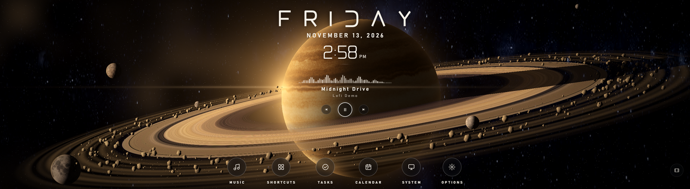
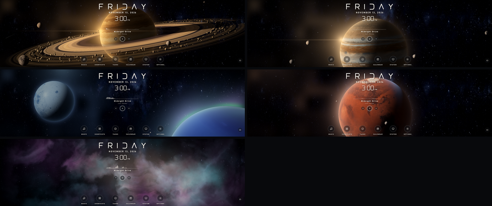
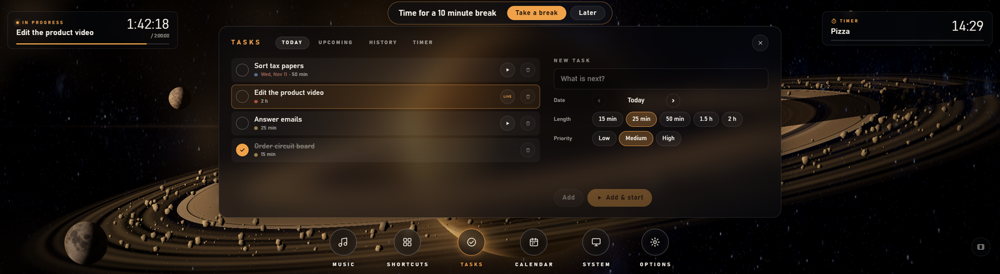
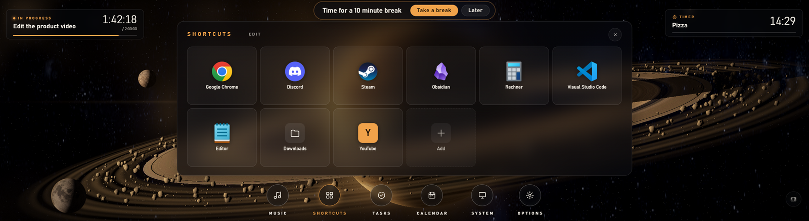
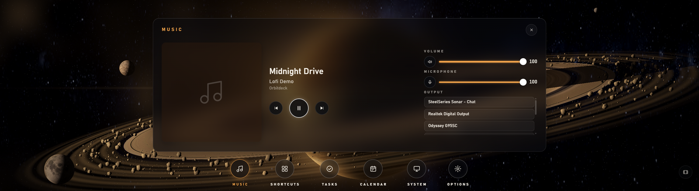
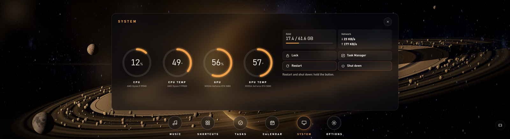
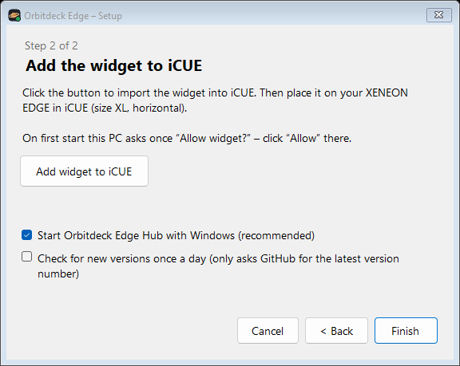
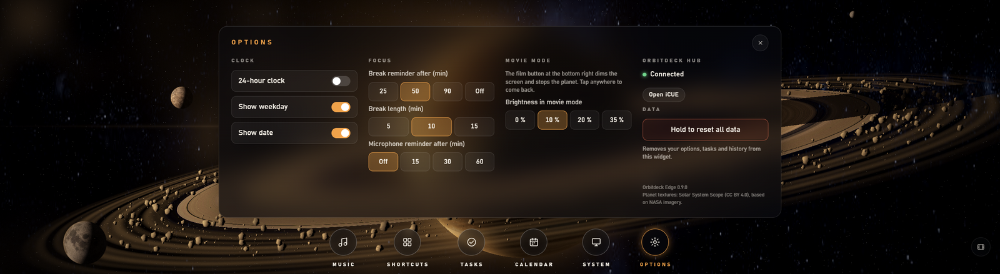

# Orbitdeck Edge

**A living space scene with a clock, tasks, music and shortcuts – on the CORSAIR XENEON EDGE.**

A ringed planet turns slowly behind a large clock, with moons on their orbits and rocks drifting through the rings. Tap the icons below it for your tasks and focus sessions, a calendar, music controls with a visualizer, your favourite programs, and CPU/GPU/RAM at a glance.

Free and open source. No account, no servers, no tracking.

> 🇩🇪 **[Deutsche Anleitung → README.de.md](README.de.md)**

**[⬇ Download the latest version](https://github.com/KaelanTesseract/orbitdeck-edge/releases/latest)** · [Setup guide](docs/SETUP.md#english) · [Privacy](PRIVACY.md#english)

---

## What it does

| | |
|---|---|
|  | **Five scenes** Ring World, Gas Giant, Ice Moon (with aurora), Red World and Nebula – real planet textures, soft light glow, rocks and moons that move in 3D. |
|  | **Tasks and focus sessions** Plan tasks for today and later, start a focus session with one tap and see it running at the top left. Break reminders, a history and a weekly overview. |
|  | **Shortcuts** Up to 12 programs, folders or web pages, picked from Windows' own list of apps – tap to start. |
|  | **Music** Play/pause, skip, title and artist of whatever is playing, a visualizer that follows the real sound, volume, mute, microphone and switching between speakers and headphones. |
|  | **System** CPU and GPU load and temperature from iCUE, RAM and network speed, plus lock, Task Manager, restart and shut down (restart and shut down need a long press). |

**Also included**

- 📅 **Calendar** with your tasks per day.
- ⏱️ **Timer** at the top right – the screen frame pulses when it is over.
- 🎬 **Movie mode** – dims the screen and stops the planet; tap anywhere to come back.
- ⌨️ **On-screen keyboard** (QWERTZ/QWERTY), because Windows shows none on the Edge.
- 🔔 **Reminders** for breaks and a microphone that has been on for a long time, with a sound.
- 🛟 **Backup** of tasks and history in the hub – they survive re-adding the widget.
- 🌍 German and English.

## Two parts: widget and hub

- The **widget** runs in iCUE on the Edge. Clock, scenes, tasks, calendar, timer, CPU/GPU and play/pause work with the widget alone.
- The optional **Orbitdeck Edge Hub** is a small app in the taskbar corner. It adds the visualizer, volume/microphone/output device, shortcuts, RAM/network, PC commands, sounds and the backup. It only talks to the widget on this PC (`localhost`, port 47822).

The installer sets up both.

## What you need

- Windows 10 or 11 (64-bit)
- CORSAIR iCUE **5.52 or newer** and a **XENEON EDGE** (slot size XL, horizontal)
- A graphics card that can do WebGL 2 (any current one). On weaker PCs lower *Rocks in Orbit* or *Render Quality*.

## Set up in three steps

**1. Install.** Download `OrbitdeckEdge-Setup-….exe` from the [latest release](https://github.com/KaelanTesseract/orbitdeck-edge/releases/latest) and run it. No admin rights are needed.
If Windows shows *“Windows protected your PC”*, click **More info → Run anyway** (the installer is not code-signed).

**2. Add the widget to iCUE.** The setup assistant opens by itself. Click **Add widget to iCUE** – iCUE opens and imports it. Place **Orbitdeck Edge** on your XENEON EDGE in the extra-large horizontal size.

**3. Allow it once.** Your PC asks *“Allow widget?”* – click **Allow**. Done.

More details and help with problems: **[Setup guide](docs/SETUP.md#english)**.

## Settings in iCUE

| Setting | What it does |
|---|---|
| Scene | Ring World, Gas Giant, Ice Moon, Red World or Nebula |
| Planet Rotation | 1.5 to 10 minutes per turn, or hold still |
| Rocks in Orbit / Render Quality | lower them on less powerful PCs |
| Animation | *Smooth* or *Power Saver* (fewer frames) |
| Light Glow | the soft glow around bright parts |
| Widget personalisation | text, accent and background colour, background transparency, tint the scene with the accent colour |

Clock format, weekday/date, focus and break lengths, microphone reminder and movie-mode brightness are set in the widget under **Options**.

## Good to know

- **Updating:** after installing a new version, remove the old widget in iCUE and add it again with the assistant (iCUE keeps the old version otherwise). Tasks and history come back from the hub's backup.
- **Swiping between Edge pages** does not work on top of the widget (iCUE hands all touches to interactive widgets) – swipe on an empty spot.
- **Sounds** come from the hub, because iCUE widgets cannot play sound themselves.

## Privacy

Orbitdeck Edge sends nothing to the internet – the only exception is the optional update check, which asks GitHub for the newest version number. Your tasks stay in iCUE and, if the hub is installed, in a backup file on your PC. Details: **[PRIVACY.md](PRIVACY.md#english)**.

## For developers

How it is built, the protocol and how to test: [docs/DESIGN.md](docs/DESIGN.md) (German) and [docs/DEVELOPMENT.md](docs/DEVELOPMENT.md).

## Credits and license

MIT – see [LICENSE](LICENSE). Third-party components: [THIRD_PARTY_NOTICES.md](THIRD_PARTY_NOTICES.md).
Planet textures: [Solar System Scope](https://www.solarsystemscope.com/textures/) (CC BY 4.0), based on NASA imagery.
Not affiliated with CORSAIR. XENEON EDGE and iCUE are trademarks of CORSAIR.
