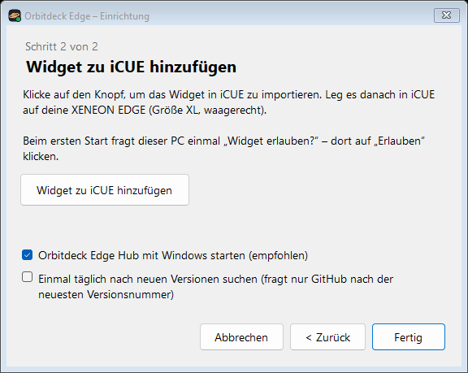
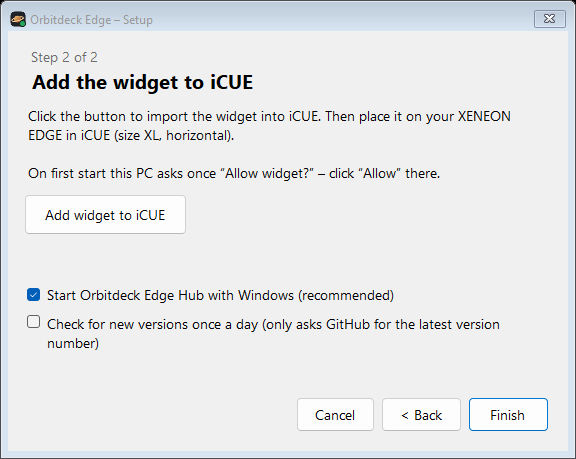

# Einrichtung / Setup – Orbitdeck Edge

[Deutsch](#deutsch) · [English](#english)

---

## Deutsch

### 1. Installieren
1. Lade `OrbitdeckEdge-Setup-….exe` aus dem [neuesten Release](https://github.com/KaelanTesseract/orbitdeck-edge/releases/latest).
2. Starte die Datei. Zeigt Windows *„Der Computer wurde durch Windows geschützt“*: **Weitere Informationen → Trotzdem ausführen**. Der Installer ist nicht signiert; die Prüfsummen stehen im Release (`SHA256SUMS.txt`).
3. Lass den Haken bei **„Orbitdeck Edge Hub mit Windows starten“** gesetzt – sonst fehlen nach einem Neustart Visualizer, Lautstärke, Shortcuts und PC-Befehle, bis du den Hub von Hand startest.

Der Hub läuft danach unten rechts in der Taskleiste (Symbol mit Ringplanet, ggf. unter „^“).

### 2. Widget zu iCUE hinzufügen

1. Im Assistenten auf **Widget zu iCUE hinzufügen** klicken. iCUE öffnet sich und importiert das Widget.
2. In iCUE das Widget **Orbitdeck Edge** in der Größe **XL waagerecht** auf eine Seite deiner XENEON EDGE ziehen.
3. Fragt iCUE nach der Berechtigung für `localhost` (Port 47822): erlauben. Über diese Adresse spricht das Widget mit dem Hub – nur auf diesem PC.

### 3. Kopplung bestätigen
Beim ersten Start erscheint am PC **„Widget erlauben?“** → **Erlauben**. Das ist pro Widget nur einmal nötig. Unter **Optionen → Orbitdeck Hub** zeigt das Widget, ob es verbunden ist. Kopplungen verwalten: Tray-Menü → „Gekoppelte Widgets …“.

### Ohne Hub
Das Widget läuft auch allein: Uhr, Szenen, Aufgaben, Kalender, Timer, CPU/GPU und Abspielen/Pause gehen ohne Hub. Visualizer, Lautstärke, Shortcuts, RAM/Netzwerk, PC-Befehle, Töne und die Sicherung brauchen ihn.

### Probleme?

| Was du siehst | Lösung |
|---|---|
| Optionen zeigen „Nicht gefunden“ | Hub starten (Startmenü → *Orbitdeck Edge Hub*). Läuft er schon: in iCUE unter **Einstellungen → Software-Einstellungen → Widget-Zugriff** den Zugriff für Orbitdeck Edge einschalten. |
| „Zugriff abgelehnt“ | In den Optionen auf **Erneut fragen** tippen und am PC **Erlauben** klicken. |
| „Bitte Widget und Hub aktualisieren“ | Widget und Hub sind unterschiedlich alt: neueste Version installieren und das Widget neu hinzufügen. |
| Planet ruckelt oder der PC wird laut | In iCUE *Brocken im Orbit* oder *Bildqualität* senken, oder *Animation: Sparsam* wählen. |
| „Dieser PC kann die 3D-Szene nicht zeichnen“ | Grafiktreiber aktualisieren. Bis dahin zeigt das Widget ein Standbild; alles andere funktioniert. |
| Keine CPU-/GPU-Werte | iCUE meldet keine Sensoren. In iCUE prüfen, ob CPU und GPU unter den Sensoren auftauchen. |
| Musik zeigt „Gerade läuft nichts“ | Der Player muss Windows seine Wiedergabe melden (Spotify, Browser, die meisten Apps tun das). |
| Kein Ton bei Timer und Erinnerungen | Töne kommen aus dem Hub über das Standard-Ausgabegerät – läuft der Hub, und ist der Hub im Windows-Lautstärkemixer nicht stumm? |
| Ein Programm fehlt in der Shortcut-Liste | Es steht nicht unter „Alle Apps“ im Startmenü. Ordner und Webseiten gehen über die anderen Reiter. |
| Etwas anderes | Tray-Menü → **Log öffnen** und die letzten Zeilen in ein [Issue](https://github.com/KaelanTesseract/orbitdeck-edge/issues) kopieren. Das Log enthält keine Aufgaben, Titel oder Programmnamen. |

### Update
Neuen Installer ausführen (Einstellungen, Shortcuts und Kopplung bleiben). Danach öffnet sich der Assistent: altes Widget in iCUE entfernen und mit **Widget zu iCUE hinzufügen** neu importieren. Aufgaben und Verlauf holt sich das neue Widget aus der Sicherung im Hub.

### Deinstallieren
Windows-Einstellungen → Apps → **Orbitdeck Edge** → Deinstallieren. Du wirst gefragt, ob auch alle Daten (Kopplungen, Shortcuts, Sicherung) gelöscht werden sollen. Das Widget selbst entfernst du in iCUE.

---

## English

### 1. Install
1. Download `OrbitdeckEdge-Setup-….exe` from the [latest release](https://github.com/KaelanTesseract/orbitdeck-edge/releases/latest).
2. Run it. If Windows shows *“Windows protected your PC”*: **More info → Run anyway**. The installer is not code-signed; checksums are in the release (`SHA256SUMS.txt`).
3. Keep **“Start Orbitdeck Edge Hub with Windows”** ticked – otherwise the visualizer, volume, shortcuts and PC commands are missing after a restart until you start the hub by hand.

The hub then runs in the taskbar corner (ringed-planet icon, maybe under “^”).

### 2. Add the widget to iCUE

1. Click **Add widget to iCUE** in the assistant. iCUE opens and imports the widget.
2. In iCUE drag **Orbitdeck Edge** onto a page of your XENEON EDGE in the **XL horizontal** size.
3. If iCUE asks for permission for `localhost` (port 47822): allow it. The widget talks to the hub through this address – on this PC only.

### 3. Confirm the pairing
On first start your PC shows **“Allow widget?”** → **Allow**. Needed once per widget. **Options → Orbitdeck Hub** in the widget shows whether it is connected. Manage pairings: tray menu → “Paired widgets …”.

### Without the hub
The widget also runs on its own: clock, scenes, tasks, calendar, timer, CPU/GPU and play/pause work without the hub. The visualizer, volume, shortcuts, RAM/network, PC commands, sounds and the backup need it.

### Problems?

| What you see | Fix |
|---|---|
| Options show “Not found” | Start the hub (Start menu → *Orbitdeck Edge Hub*). Already running: in iCUE turn on access for Orbitdeck Edge under **Settings → Software Settings → Widget Access**. |
| “Access denied” | Tap **Ask again** in the options and click **Allow** on your PC. |
| “Please update widget and hub” | Widget and hub differ in age: install the latest version and add the widget again. |
| The planet stutters or the PC gets loud | Lower *Rocks in Orbit* or *Render Quality* in iCUE, or choose *Animation: Power Saver*. |
| “This PC cannot draw the 3D scene” | Update the graphics driver. Until then the widget shows a still image; everything else works. |
| No CPU/GPU values | iCUE reports no sensors. Check in iCUE that CPU and GPU show up among the sensors. |
| Music shows “Nothing is playing” | The player has to report its playback to Windows (Spotify, browsers and most apps do). |
| No sound for timers and reminders | Sounds come from the hub on the default output device – is the hub running, and is it not muted in the Windows volume mixer? |
| A program is missing from the shortcut list | It is not under “All apps” in the Start menu. Folders and web pages have their own tabs. |
| Something else | Tray menu → **Open log** and paste the last lines into an [issue](https://github.com/KaelanTesseract/orbitdeck-edge/issues). The log contains no tasks, titles or program names. |

### Update
Run the new installer (settings, shortcuts and pairing are kept). The assistant then opens: remove the old widget in iCUE and import it again with **Add widget to iCUE**. The new widget gets your tasks and history back from the hub's backup.

### Uninstall
Windows Settings → Apps → **Orbitdeck Edge** → Uninstall. You are asked whether to delete all data too (pairings, shortcuts, backup). Remove the widget itself in iCUE.
